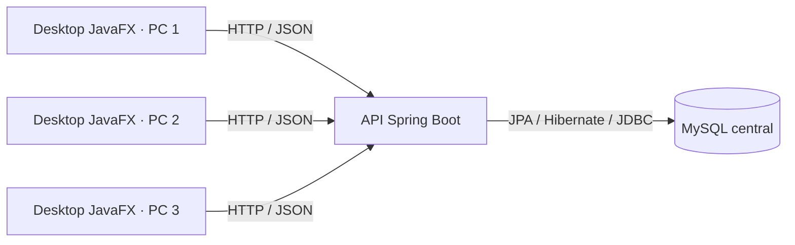
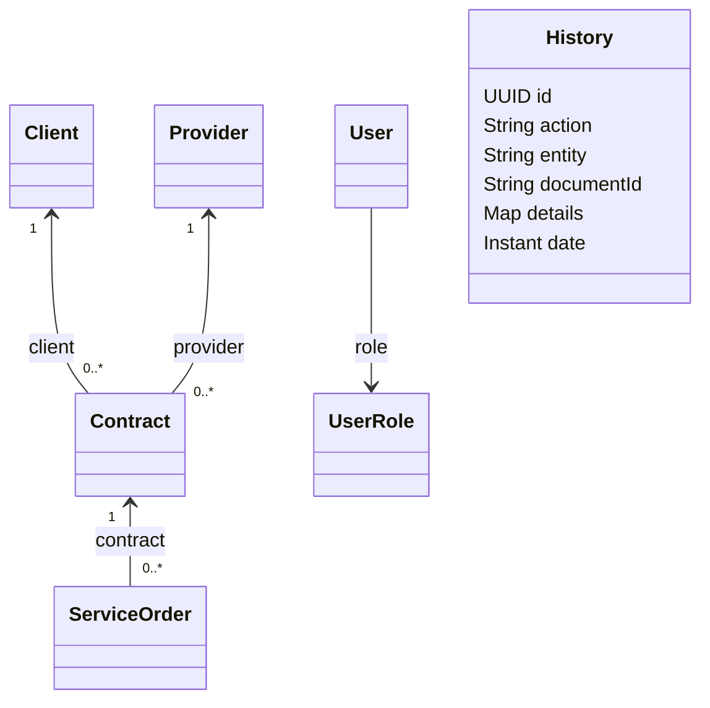
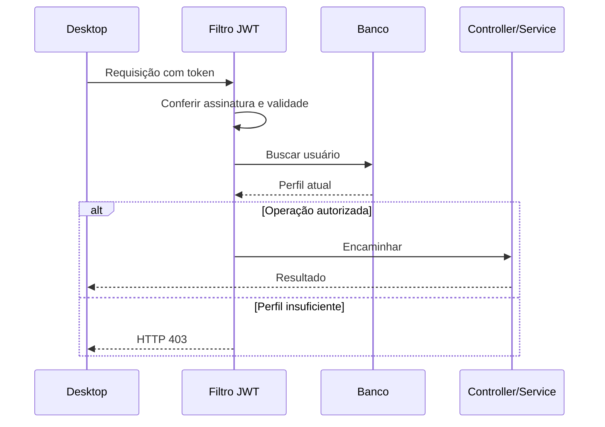

# Arquitetura e comportamento atual

## Componentes



Uma das máquinas pode executar a API, o MySQL e um desktop. As outras executam o desktop apontando para a mesma API. As credenciais do banco são utilizadas pela API; o desktop utiliza sua conta e o token de sessão.

O transporte configurado atualmente é HTTP na intranet. HTTPS não está configurado pelo projeto.

## Camadas

| Módulo/pacote | Responsabilidade |
|---|---|
| Backend `controller` | Receber requisições, validar DTOs e encaminhar operações |
| Backend `service` | Aplicar as regras existentes, coordenar transações e construir respostas |
| Backend `repository` | Consultas e persistência por interfaces Spring Data JPA |
| Backend `entity` | Representar tabelas e relacionamentos |
| Backend `config` | Filtro JWT, autorização, configuração HTTP e OpenAPI |
| Backend `dto` / `exception` | Contratos JSON e tradução de falhas em respostas HTTP |
| Desktop `ui` | Navegação, controles, tabelas e formulários JavaFX |
| Desktop `validation` | Conferir dados antes de enviar o formulário |
| Desktop `service` | Coordenar chamadas, preservar/traduzir erros e calcular indicadores |
| Desktop `api` | Clientes Feign, token e decoder de erros |
| Desktop `session` / `config` | Estado da sessão, arquivo local, URL e prazos de comunicação |

O desktop inicia um contexto Spring sem servidor web. `DesktopFxApplication` integra esse contexto ao ciclo JavaFX. `FxAsync` executa rede/processamento fora da thread dos controles e entrega os callbacks ao ciclo JavaFX.

## Modelo persistido



`History.documentId` é uma referência textual auxiliar, não uma associação JPA com chave estrangeira para todas as entidades. A figura não cria vínculos de autoria que não existem no código.

| Entidade | Características atuais |
|---|---|
| `User` | UUID, nome, e-mail único, senha BCrypt, perfil e timestamps |
| `Client` | PJ, CNPJ único por texto armazenado, um e-mail/telefone/endereço e situação |
| `Provider` | Documento, especialidade, contato e disponível/ocupado; sem subtipos |
| `Contract` | Exatamente um cliente e um prestador, período, valor e situação |
| `ServiceOrder` | Exatamente um contrato, descrição, data de execução, situação e timestamps |
| `History` | Ação, entidade, referência textual, detalhes JSON e data |

Datas operacionais usam `LocalDate`; timestamps usam `Instant`. Valores monetários usam `BigDecimal`. Os IDs públicos são UUIDs no campo `id`.

Estados JSON:

- Cliente: `active`, `inactive`.
- Contrato: `active`, `closed`.
- Ordem: `pending`, `in_progress`, `completed`, `canceled`.
- Conta: `adm`, `user`. O banco persiste os nomes `ADM` e `USER`.

## Autenticação e autorização

1. `UserService` normaliza o e-mail e compara a senha com o hash BCrypt.
2. `JwtService` emite JWT HS256 com identidade, nome, e-mail, perfil e expiração configurada. O prazo padrão é oito horas.
3. `AuthTokenInterceptor` acrescenta `Authorization: Bearer ...` às chamadas Feign com sessão.
4. `JwtAuthenticationFilter` valida assinatura/expiração, busca a conta e consulta `AccessPolicy` com o perfil **atual no banco**.
5. A operação prossegue ou retorna 401/403.



O campo de perfil no JWT e o arquivo local não substituem a consulta do banco. Uma alteração de perfil pode bloquear imediatamente um token antigo. Conta excluída não continua acessando a API com seu token anterior.

O arquivo de sessão tem caminho configurável. `JwtExpiry` apenas lê a expiração do payload; não verifica assinatura. Ao restaurar, `AuthService` consulta `GET /api/auth/me` para obter a identidade e o perfil do servidor. A leitura local orienta a experiência; a API aplica a segurança.

O logout limpa a sessão local. Ainda não existe revogação central de todos os tokens, inativação de contas ou gestão de perfis por tela. Consulte o [procedimento do primeiro ADM](../backend/PERFIS_DE_ACESSO.md).

## Operações e API

| Recurso | Base | Métodos existentes |
|---|---|---|
| Contas | `/api/auth` | POST `/register`, POST `/login`, GET `/me` |
| Clientes | `/api/clientes` | GET lista/id, POST, PUT id, DELETE id |
| Prestadores | `/api/prestadores` | GET lista/id, POST, PUT id, DELETE id |
| Contratos | `/api/contratos` | GET lista/id, POST, PUT id, DELETE id |
| Ordens | `/api/ordens-servico` | GET lista/id, POST, PUT id, DELETE id |
| Histórico | `/api/historico` | GET e POST |

As rotas de dados e `/api/auth/me` exigem token. Cadastro, login, raiz e documentação da API são públicos. O grupo de operação e o perfil determinam a autorização, conforme [a matriz de acesso](../backend/PERFIS_DE_ACESSO.md).

`PUT` aceita atualização com campos opcionais: os serviços preservam os valores dos campos não enviados/nulos. Isso não oferece uma operação genérica para apagar qualquer campo com `null`.

As escritas de aplicação usam `@Transactional`; as leituras usam transações de leitura. `EntityGraph` nos repositórios de contrato e ordem carrega os relacionamentos usados nos DTOs. Transação não substitui teste de concorrência, backup e recuperação.

## Caminho das mensagens de erro

```json
{
  "status": "error",
  "error": "Validation failed",
  "details": [
    { "field": "email", "message": "must be a well-formed email address" }
  ]
}
```

O decoder lê `error`/`details`, mantém alternativas de formatos anteriores, traduz validações comuns e reúne mensagens sem duplicação. `ApiException.hasValidationDetails()` indica que o serviço deve preservar a lista.

Exemplo apresentado: `E-mail: Informe um e-mail válido.` Conflitos de documento e recursos/vínculos inexistentes mantêm seu motivo para tradução no serviço. Mensagens desconhecidas e traduções novas precisam ser avaliadas conforme o contrato da API.

| Status | Interpretação no desktop |
|---|---|
| 400 | Conferir os dados; detalhes por campo quando disponíveis |
| 401 no login | Credencial inválida |
| 401 em consulta protegida | Sessão inválida/expirada; novo login |
| 403 | Perfil insuficiente |
| 404 | Registro ou vínculo não encontrado |
| 409 | Conflito de documento ou integridade |
| 500 e superiores | Mensagem genérica de falha do servidor |

Corpo vazio, HTML ou JSON ilegível recebe mensagem alternativa. Detalhes internos de falha 500 não são apresentados ao usuário.

## Indicadores e histórico

`DashboardService` obtém listas inteiras de clientes, prestadores, contratos e ordens, e calcula as contagens no desktop. A paginação visual das telas também acontece após carregar as listas; não é paginação da consulta SQL.

`AuditLog` solicita um evento após a operação principal do desktop. Se essa solicitação falha, o fluxo principal continua. Chamadas diretas à API não produzem automaticamente os mesmos eventos. O histórico é auxiliar, sem garantia de completude, autoria ou imutabilidade.

## Limites e alinhamento de escopo

O código ainda usa contratos, não o modelo completo de projetos, tipos, prestações, equipes, pagamentos e avaliações dos documentos revisados. Alterar o nome de uma entidade não reconcilia esses vínculos.

Também permanecem pendentes: validação dos dígitos de CPF/CNPJ e normalização no servidor; política uniforme de inativação; validações de período no backend; regras de transição de estado; contato/endereço múltiplos; paginação de banco; controle de alterações concorrentes; comprovação de desempenho, backup/restauração e execução em três máquinas.

A documentação descreve o comportamento implementado e serve de base para a evolução. A presença de um pacote, tela ou teste não comprova o atendimento integral aos requisitos do PI.
