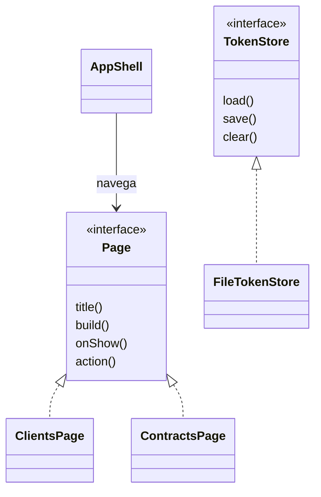

# Conceitos de orientação a objetos no GVS

Os exemplos abaixo apontam para código existente. Eles explicam como o projeto utiliza POO; não implicam que todo o escopo acadêmico já esteja implementado.

## Encapsulamento

[AuthSession](../desktop/src/main/java/com/h_group/gvs_terceirizacoes_desktop/session/AuthSession.java) mantém o estado da sessão privado e o manipula por métodos próprios, sincronizados. [ApiException](../desktop/src/main/java/com/h_group/gvs_terceirizacoes_desktop/api/ApiException.java) reúne status HTTP, mensagem e detalhes de validação, permitindo que os serviços tratem uma falha como um objeto.

Ter um atributo `private` não torna o objeto imutável. Entidades com setters, inclusive os gerados pelo Lombok, continuam mutáveis; encapsular também exige definir por quais operações o estado pode mudar.

## Abstração e interfaces

[Page](../desktop/src/main/java/com/h_group/gvs_terceirizacoes_desktop/ui/Page.java) define o contrato de uma página: título, construção do conteúdo, ação e evento de exibição. A navegação consegue trabalhar com esse contrato sem precisar repetir a lógica de cada tela.

[TokenStore](../desktop/src/main/java/com/h_group/gvs_terceirizacoes_desktop/session/TokenStore.java) define `load`, `save` e `clear`. [FileTokenStore](../desktop/src/main/java/com/h_group/gvs_terceirizacoes_desktop/session/FileTokenStore.java) implementa esse contrato com arquivo local. A abstração permite fornecer outra implementação, como armazenamento de teste, sem exigir que o serviço conheça detalhes do sistema de arquivos.

Os repositórios do backend também usam interfaces do Spring Data JPA: a aplicação declara o contrato de persistência e o framework fornece a implementação em execução.

## Polimorfismo

[AppShell](../desktop/src/main/java/com/h_group/gvs_terceirizacoes_desktop/ui/AppShell.java) mantém um `Map<String, Page>`. Ao navegar, chama `title()`, `action()`, `build()` e `onShow()` pela referência `Page`; o método executado depende da página concreta, como `ClientsPage` ou `ContractsPage`.

Esse é um exemplo de polimorfismo por interface: o mesmo ponto de chamada atende implementações diferentes. A troca do `TokenStore` recebido pelo serviço é outro exemplo.

## Herança, sobrescrita e sobrecarga

`ApiException extends RuntimeException` especializa uma exceção Java com informações da API. `DesktopFxApplication extends Application` participa do ciclo de vida JavaFX, implementando métodos como `init`, `start` e `stop`.

**Sobrescrita** fornece uma implementação para um método herdado ou definido por interface, como os métodos de `FileTokenStore` e das páginas. A anotação `@Override` ajuda o compilador a conferir a assinatura.

**Sobrecarga** usa o mesmo nome com parâmetros diferentes. [JwtExpiry](../desktop/src/main/java/com/h_group/gvs_terceirizacoes_desktop/session/JwtExpiry.java) possui `isExpired(String token)` e `isExpired(String token, Instant now)`. A primeira usa o instante atual; a segunda permite informar um instante, útil para testes previsíveis.

Não existe uma hierarquia em que cliente ou prestador herdem de contrato: essas classes se relacionam por associação.

## Associação e composição

No modelo persistido, um contrato referencia um cliente e um prestador; uma ordem de serviço referencia um contrato. As anotações JPA mapeiam essas associações e suas chaves no banco. A [arquitetura](ARQUITETURA.md) descreve as cardinalidades existentes.

No desktop, `AppShell` monta suas páginas e organiza os controles da interface. Essa composição reúne objetos menores para realizar a navegação. [PageDependencies](../desktop/src/main/java/com/h_group/gvs_terceirizacoes_desktop/ui/PageDependencies.java) agrupa referências aos serviços e validadores usados na construção das páginas. Uma referência Java, sozinha, não estabelece dependência de ciclo de vida nem exclusão em cascata no banco.

## Injeção de dependências e separação de responsabilidades

Serviços recebem suas dependências pelo construtor, explícito ou gerado pelo Lombok. O Spring fornece componentes como serviços, repositórios e clientes Feign; não é necessário que cada classe crie manualmente suas dependências de infraestrutura.

No backend, controller recebe HTTP e valida o formato de entrada, service coordena regras/transações e repository consulta/persiste. No desktop, páginas apresentam controles, serviços coordenam chamadas e clientes Feign descrevem o acesso HTTP. Ocultar um botão administrativo melhora a interface; a autorização definitiva continua no backend.

Essa divisão facilita testar uma responsabilidade com dependências controladas. Ela não garante, por si, que todas as regras do negócio estejam implementadas.

## Records e DTOs

DTOs transportam dados sem expor diretamente entidades persistidas. Records declaram componentes e geram construtor, acessores e operações de valor. Suas referências não podem ser reatribuídas depois da construção, mas coleções/objetos referenciados podem continuar mutáveis se não houver cópia defensiva.

Por exemplo, receber dados em um DTO e validá-los na interface não dispensa a validação na API. Da mesma forma, um campo `role` recebido do cadastro não deve decidir privilégios: o cadastro público do GVS sempre cria USER e o servidor consulta o perfil persistido ao autorizar requisições.

## Limites para a apresentação

O código atual demonstra Java, aplicação desktop, comunicação cliente/servidor e perfis ADM/USER. O requisito de funcionamento com três máquinas ainda depende de ensaio registrado. O domínio implementado usa contratos; projetos, equipes, pagamentos e outras partes do escopo revisado ainda precisam ser alinhados. Apresente exemplos verificáveis no código e os resultados realmente executados, conforme [testes e Javadoc](TESTES_E_JAVADOC.md).
